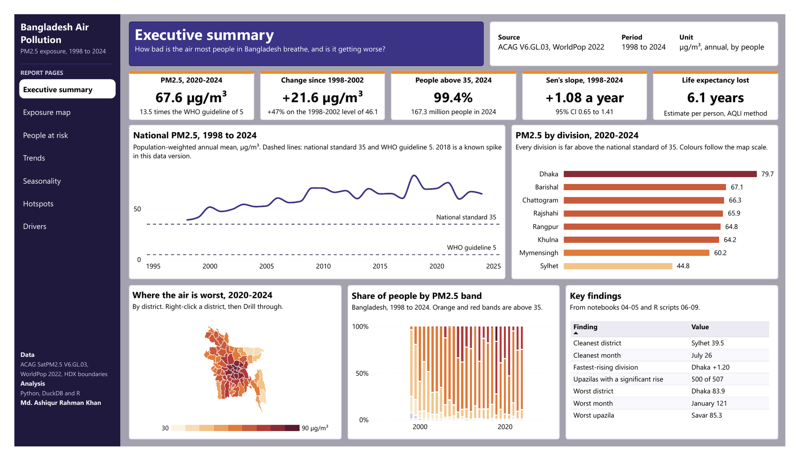
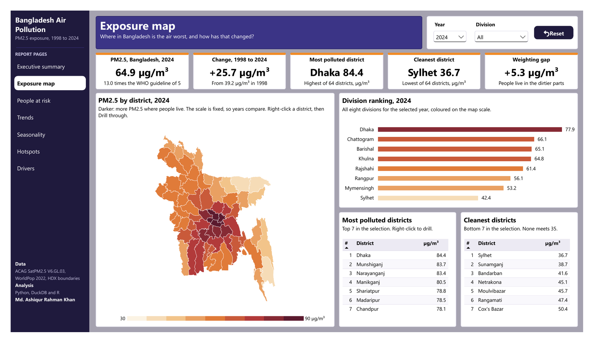
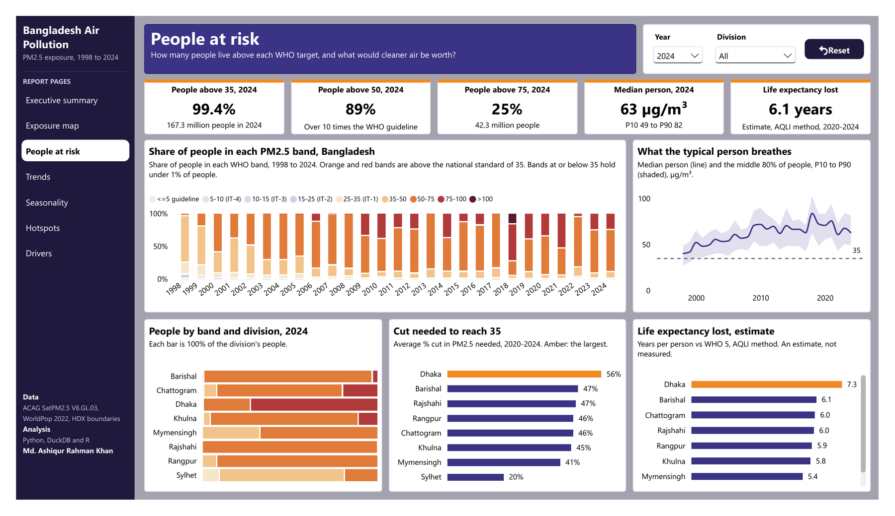
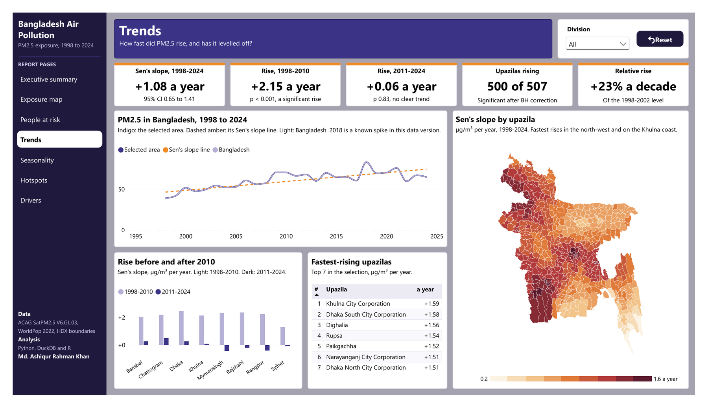
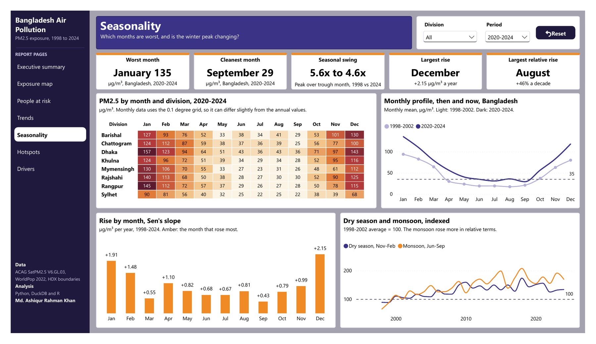
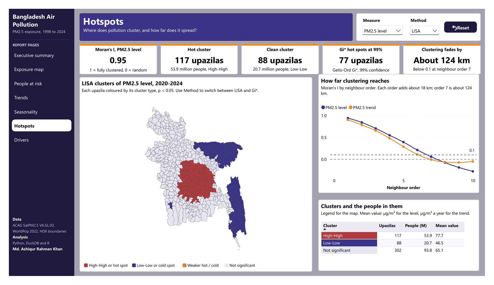
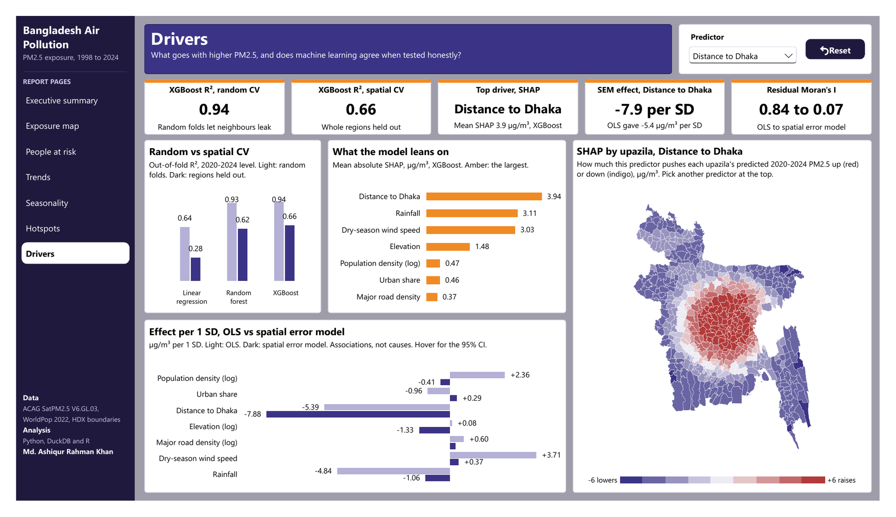

# Bangladesh Air Pollution Exposure Analysis

How much fine particulate pollution (PM2.5) do people in Bangladesh breathe, where is it worst, and how has it changed since 1998? This project answers that for the whole country, 8 divisions, 64 districts and 507 upazilas, using satellite-based PM2.5 estimates weighted by where people actually live.

The work covers raster processing in Python, SQL in DuckDB, trend and spatial statistics in R, machine learning with spatial cross-validation, and a Power BI dashboard.

By Md. Ashiqur Rahman Khan



## What I found

- **The average person breathes 67.6 µg/m³** (2020-2024, population-weighted). That is 13.5 times the WHO guideline of 5 µg/m³. In 1998-2002 it was 46.1, so the rise is 21.6 µg/m³, or 47%.
- **Almost nobody meets any target.** In 2024, 99.4% of people (167.3 million) lived above 35 µg/m³, which is both the WHO interim target 1 and the Bangladesh national standard. 89% lived above 50 and 25% above 75. Every person in every year is above the WHO guideline.
- **The rise stopped around 2010.** The national Sen's slope over 1998-2024 is +1.08 µg/m³ per year (95% CI 0.65 to 1.41). But split in two, it was +2.15 per year in 1998-2010 and only +0.06 per year (p 0.83) in 2011-2024. So PM2.5 climbed to a plateau and stayed there. 500 of 507 upazilas still show a significant rise over the full period.
- **Dhaka is worst, Sylhet is cleanest.** Dhaka district averaged 83.9 µg/m³ in 2020-2024 and Sylhet district 39.5. The worst upazila is Savar at 85.3. No division changed its rank across the years.
- **Winter is several times worse than the monsoon.** January averages 121 µg/m³ and July 26. December rose the most in absolute terms (+2.15 µg/m³ per year). August rose the most in relative terms (+46% of its 1998-2002 level per decade), so the gap between seasons narrowed from 5.6x to 4.6x.
- **Pollution is strongly clustered.** Moran's I is 0.95 for the level and 0.91 for the trend. One hot cluster around Dhaka holds 117 upazilas and 53.9 million people. The clean cluster is in Sylhet. The clustering fades by about 124 km.
- **Population weighting matters in a way I did not expect.** The gap between population-weighted and area-weighted PM2.5 is largest in Bagerhat, Khulna, Bhola, Lakshmipur and the Hill Tracts, where large areas are empty and cleaner. It is not larger in dense districts (Spearman 0.02 with density).
- **Distance to Dhaka is the strongest driver.** In XGBoost, distance to Dhaka, rainfall and dry-season wind are the top SHAP features. Population density, urban share and roads add very little at upazila level.
- **Random cross-validation overstated the ML models.** XGBoost reached R² 0.94 with random folds but 0.66 when whole regions were held out. Linear regression dropped from 0.64 to 0.28. Neighbouring upazilas leak information into random folds.
- **The spatial error model changes the story for weather.** In OLS, rainfall (-4.8 µg/m³ per SD) and dry-season wind (+3.7) look important. In the spatial error model they shrink to -1.1 and +0.4, while distance to Dhaka (-7.9) and elevation (-1.3) hold.
- **Cleaner air would add years of life.** Using the AQLI method, the average person loses an estimated 6.1 years of life expectancy against the WHO guideline (Dhaka division 7.3, Sylhet 3.9). Meeting only the national standard of 35 would win back about 3.2 years. Reaching 35 needs an average cut of 46%. These are estimates from a published relationship, not measured outcomes.

## Dashboard

Seven report pages, a District profile drill-through, and seven tooltip pages (a KPI glossary plus area, year, month, band, cluster and predictor tooltips). The maps use custom TopoJSON files for the 64 districts and 507 upazilas, built from the HDX boundaries.

| Page | Question it answers |
|---|---|
| Executive summary | How bad is the air most people breathe, and is it getting worse? |
| Exposure map | Where is the air worst, and how has that changed? |
| People at risk | How many people live above each WHO target, and what would cleaner air be worth? |
| Trends | How fast did PM2.5 rise, and has it levelled off? |
| Seasonality | Which months are worst, and is the winter peak changing? |
| Hotspots | Where does pollution cluster, and how far does it spread? |
| Drivers | What goes with higher PM2.5, and does machine learning agree when tested honestly? |
| District profile | Drill-through: one district, its trend, months, bands and upazilas |

The full dashboard is in `Air Pollution Dashboard.pbix`, and a PDF export is in `Air Pollution Dashboard.pdf`.








## Report

The full write-up is in [`Bangladesh Air Pollution Exposure Analysis Report.pdf`](Bangladesh%20Air%20Pollution%20Exposure%20Analysis%20Report.pdf) (40 pages). It covers the data and quality checks, the methods, one chapter for each of the seven questions, the life expectancy estimate, the dashboard and the limitations, with all the figures and tables from the notebooks and R scripts.

## Why I did it this way

**01 Data collection (Python).** I downloaded the ACAG SatPM2.5 V6.GL.03 annual files (0.01°, about 1 km) and monthly files (0.1°) for 1998 to 2024 from the public AWS bucket, and cropped each one to Bangladesh right away so Colab would not run out of disk. I used one data version for all 27 years, because mixing versions creates false jumps in a trend. WorldPop 2022 (constrained, 100 m) gives the population and HDX gives the boundaries. Every download is logged in `data/raw/download_manifest.csv`.

**02 Raster processing (Python).** I aligned WorldPop to the PM2.5 grid and computed population-weighted and area-weighted means for every upazila, district, division and the country, for every year and month. Weighting by people matters because PM2.5 over empty land is not what anyone breathes. I also built the WHO exposure bands here. The 2018 value in V6.GL.03 is about 28% above its neighbouring years, while the previous release showed about 3%. I kept 2018, flagged it on every time chart, and used Sen's slope for trends because it is not pulled by one outlier (+1.07 per year without 2018, almost the same).

**03 DuckDB SQL (Python).** 12 queries for coverage checks, national and division rankings, period change, district and upazila extremes, people by WHO band, seasonal profile, dry season vs monsoon, the 2018 sensitivity check and the weighting gap.

**04 Exploratory analysis (Python).** Trend lines by division, month by year and month by division heatmaps, the exposure distribution, recent change maps and the weighting gap. This is where I saw the plateau after 2010 and the strong winter peak.

**05 ML drivers (Python).** For each upazila I added population density, urban share, distance to Dhaka, elevation (Copernicus DEM), major road density (OpenStreetMap), and dry-season wind and rainfall (NASA POWER). I compared linear regression, random forest and XGBoost with both random and spatial cross-validation. Spatial CV holds out whole regions, which is the honest test for spatial data. SHAP shows what the model leans on.

**06 Trends and seasonality (R).** Mann-Kendall tests with the Hamed-Rao correction for autocorrelation, Sen's slope for every area, Benjamini-Hochberg correction across the 507 upazilas, a split at 2010 to test the plateau, monthly slopes, and STL decomposition of the monthly series to measure the seasonal swing.

**07 Spatial autocorrelation (R).** Global Moran's I with queen and 6-nearest-neighbour weights, a correlogram to see how far clustering reaches, LISA clusters and Getis-Ord Gi* hot spots. I also checked the Moran's I of the ML residuals, which showed why random CV looked too good (0.21 random vs 0.82 spatial).

**08 Spatial regression (R).** OLS first, then Lagrange multiplier tests on its residuals (residual Moran's I 0.84). I fitted SAR, SEM, SLX, SDM and SDEM. SDM had the lowest AIC, but its rho of 0.97 makes the impact estimates unstable, so I interpret the spatial error model, which brings the residual Moran's I down to 0.07.

**09 WHO exposure (R).** People in each band by area and year, exposure percentiles (P10 to P90), the cut needed to reach each target, and life expectancy lost with the AQLI method.

**10 Power BI export (R).** 27 CSVs: dimension, fact, statistics and model tables, plus the findings, glossary, relationships and table dictionary. The dashboard only looks up and formats these results, so its numbers match the notebooks and scripts.

**Power BI.** I built the semantic model with the Power BI modeling MCP connector (25 tables, 21 relationships, about 120 measures) and the report pages as PBIR files. Colour scales on the maps are fixed, so years can be compared.

## Files

| File | What it does |
|---|---|
| `notebooks/01_data_collection.ipynb` | Downloads PM2.5, WorldPop and boundaries, crops to Bangladesh |
| `notebooks/02_raster_processing.ipynb` | Population-weighted means by area, year and month, WHO bands |
| `notebooks/03_duckdb_sql_analysis.ipynb` | 12 SQL queries in DuckDB |
| `notebooks/04_exploratory_analysis.ipynb` | Exploratory figures |
| `notebooks/05_ml_drivers.ipynb` | Covariates, random vs spatial CV, SHAP |
| `r/06_trends_seasonality.R` | Mann-Kendall, Sen's slope, STL |
| `r/07_spatial_autocorrelation.R` | Moran's I, correlogram, LISA, Gi* |
| `r/08_spatial_regression.R` | OLS, LM tests, SAR, SEM, SDM, model comparison |
| `r/09_who_exposure.R` | WHO bands, percentiles, cut needed, AQLI years of life |
| `r/10_powerbi_export.R` | Tables for the dashboard |
| `Bangladesh Air Pollution Exposure Analysis Report.pdf` | Full analysis report |

## Limitations

- These are modelled satellite estimates, not monitor readings. At 1 km they are smoother than reality and miss street-level peaks.
- WorldPop 2022 is used to weight every year. The trend shows how pollution changed where people live now, not exactly what people breathed in 1998.
- The 2018 value in this data version looks too high. It is kept and flagged, and the trend methods are robust to it.
- Monthly data is on the coarser 0.1° grid. For a few small coastal upazilas the monthly averages differ from the annual value by up to 11 µg/m³, so the seasonality page stays at division and district level.
- Regression and SHAP describe places, not people or causes.
- High Moran's I partly reflects the smooth satellite surface itself.
- Life expectancy lost is an AQLI estimate from a published exposure-response relationship. This project does not measure deaths or disease.

## Project structure

```
Bangladesh Air Pollution Project/
├── data/
│   ├── raw/download_manifest.csv   (raw files are re-created by notebook 01)
│   └── processed/                  (area panels, WHO bands, covariates; the 1 km grid and
│                                    boundary GeoPackage are re-created by notebooks 01 and 02)
├── notebooks/                      (01 to 05, Python, Colab)
├── r/                              (06 to 10, R)
├── outputs/
│   ├── figures/                    (notebook figures)
│   ├── tables/
│   ├── sql_results/
│   ├── models/
│   ├── R/                          (R figures and tables)
│   └── powerbi/                    (27 CSVs for the dashboard)
├── images/                         (dashboard screenshots)
├── Air Pollution Dashboard.pbix
├── Air Pollution Dashboard.pdf
├── Bangladesh Air Pollution Exposure Analysis Report.pdf
├── requirements.txt
└── README.md
```

## How to run

1. Put the project folder in Google Drive and open the notebooks in Colab. Each notebook sets `ROOT` to `/content/drive/MyDrive/Bangladesh Air Pollution Project`, so change it if your folder is somewhere else. Run 01 to 05 in order. The Python packages are in `requirements.txt`.
2. Copy the folder to your computer and run the R scripts 06 to 10 in order in RStudio. Each script starts with `setwd("E:/Bangladesh Air Pollution Project")`, so change that path. Packages used: arrow, dplyr, tidyr, ggplot2, sf, terra, trend, modifiedmk, spdep, spatialreg, lmtest, car, patchwork.
3. Open `Air Pollution Dashboard.pbix` in Power BI Desktop. The data is already inside. To refresh it from your own copy, change the `DataFolder` parameter to your `outputs/powerbi` folder.

## Data sources

- PM2.5: [ACAG SatPM2.5 V6.GL.03](https://sites.wustl.edu/acag/datasets/surface-pm2-5), Washington University in St. Louis, annual 0.01° and monthly 0.1°, 1998 to 2024
- Population: [WorldPop 2022 constrained, 100 m](https://www.worldpop.org/)
- Boundaries: [HDX Bangladesh administrative boundaries (cod-ab-bgd)](https://data.humdata.org/dataset/cod-ab-bgd)
- Covariates: Copernicus DEM (elevation), OpenStreetMap (roads), NASA POWER (wind and rainfall)
- WHO 2021 air quality guidelines, Bangladesh Air Pollution (Control) Rules 2022, and the AQLI method (Ebenstein et al. 2017)

## Author

Md. Ashiqur Rahman Khan
B.Sc. in Statistics, Mawlana Bhashani Science and Technology University
[LinkedIn](https://www.linkedin.com/in/md-ashiqur-rahman-khan-b475b1316/) · [GitHub](https://github.com/Ashiq-r-khan) · [Portfolio](https://ashiq-r-khan.github.io/)
